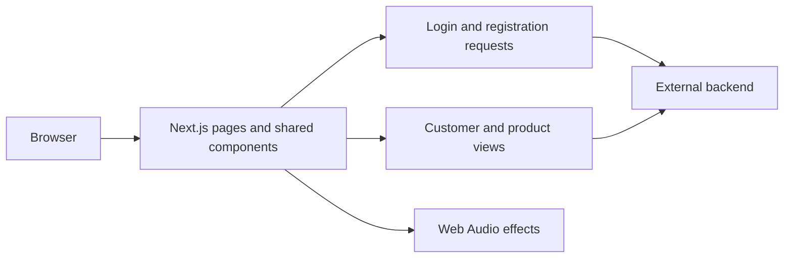

# VoiceAgent

**A web interface for exploring a voice-agent product and managing its customers and products.**

This repository contains the Next.js frontend: an animated product page, interactive demo components, authentication screens, and a tabbed management dashboard. Backend services are configured separately.

[Get started](#get-started) · [Backend connection](#backend-connection) · [Architecture](#architecture)

## The problem it explores

A voice automation product needs more than a call interface. Users also need to understand the product, sign in, and manage the business data behind their workflows. This frontend brings those surfaces into one application for UI development and integration work.

## What's included

- Responsive product page with animated sections and demo components.
- `/login` and `/signup` forms connected to an external authentication API.
- `/dashboard` with dashboard, customer, and product tabs.
- Shared cards, forms, Radix-based UI components, and Tailwind styling.
- Web Audio sound effects and a persisted audio preference.

The product-page descriptions communicate the product concept. This repository alone does not provide telephony infrastructure or an LLM voice runtime.

## Get started

Download and extract the repository from GitHub. From the root, with Node.js and npm installed:

```bash
npm install
npm run dev
```

Open `http://localhost:3000`. To build and serve the Next.js application:

```bash
npm run build
npm start
```

## Backend connection

The API base URL is defined in [lib/constants.ts](lib/constants.ts). Review that setting before using account or management features; the backend source is not included here.

The authentication screens call these relative endpoints on that server:

| Action | Endpoint |
| --- | --- |
| Register | `POST /auth/register` |
| Sign in | `POST /auth/login` |

The frontend expects login to return a token and stores it in browser local storage. A reachable compatible backend is required for these workflows; opening the marketing page does not verify backend availability.

## Example workflow

1. Open the home page and explore the product presentation.
2. Configure a compatible backend in `lib/constants.ts`.
3. Register or sign in using the provided screens.
4. Open `/dashboard` and switch between the management tabs.

## Architecture



## Source guide

| Path | Purpose |
| --- | --- |
| [app/page.tsx](app/page.tsx) | Product landing page |
| [app/dashboard/page.tsx](app/dashboard/page.tsx) | Tabbed management shell |
| [app/pages](app/pages) | Dashboard, customer, and product views |
| [components/forms](components/forms) | Management forms |
| [hooks/use-audio.ts](hooks/use-audio.ts) | Browser sound effects |
| [lib/constants.ts](lib/constants.ts) | Backend URL configuration |

## Development notes

Keep demo behavior separate from backend-backed features when extending the UI. Validate response shapes and error states against the backend you connect. The repository contains both npm and pnpm lockfiles; use one package manager consistently for a given development environment.
